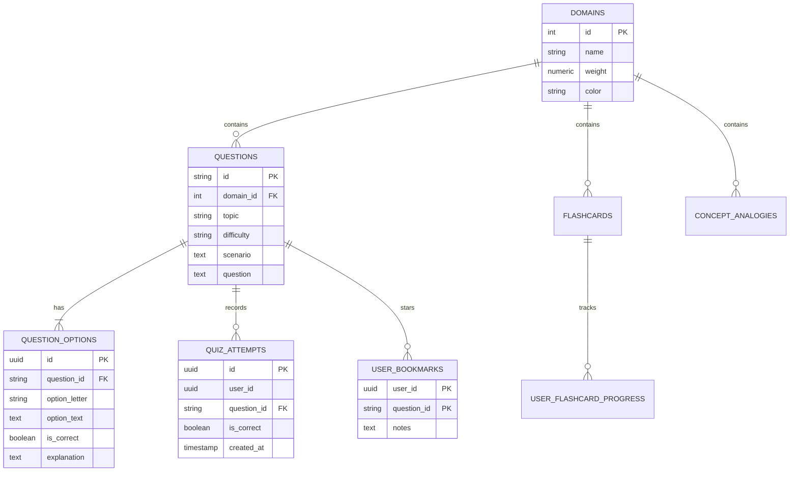

# AzureVibe — Intelligent AZ-900 Exam Prep Suite 🚀

> **Building Smarter Exam Prep Tools from Our Own Learning Journey.**  
> Built for the **1 Million Devs Vibe Coding Hackathon (AZ-900 Edition)** organized by **Power Learn Project Africa (#1MillionDevs)**.

---

## 🌟 Executive Summary

Preparing for the **Microsoft Certified: Azure Fundamentals (AZ-900)** exam can feel overwhelming. Beginners face abstract cloud jargon, struggle to distinguish overlapping services (e.g., ExpressRoute vs. VPN, Azure Policy vs. RBAC), and lack objective visibility into whether they are truly ready to pass.

**AzureVibe** is a unified, high-vibe exam preparation suite that solves these pain points through active learning, real-world analogies, and a domain-weighted readiness engine mapped to the **3 official Microsoft AZ-900 learning paths**.

---

## 🎯 The 5 Core Challenges Solved

| Problem Statement | AzureVibe Solution | Feature Highlight |
| :--- | :--- | :--- |
| **1. Practice & Assessment** | **Smart Quiz Arena** | Instant feedback with architectural justifications explaining *why* the right answer works and *why* each distractor is wrong. |
| **2. Memory & Revision** | **3D Flashcard Coach** | Tactile 3D card flips with Leitner active recall ("Still Confused" vs. "Nailed It") and exam trap warnings. |
| **3. Conceptual Support** | **AI Study Buddy** | Abstract cloud concepts simplified through relatable, everyday African analogies (e.g., M-Pesa nodes, regional logistics, building codes). |
| **4. Planning & Cadence** | **Personal Study Planner** | Calculates days remaining until your exam date and generates a custom daily syllabus roadmap. |
| **5. Readiness & Diagnostics** | **Readiness Speedometer** | Animated gauge with composite weighted scoring ($28\%$ Concepts, $37\%$ Architecture, $35\%$ Governance) and a 700/1000 passing threshold indicator. |

---

## 🧠 Curriculum Alignment: 3 Official AZ-900 Domains

Every question, card, and metric is synchronized with the Microsoft Learn AZ-900 skills outline:

```
AZ-900: Microsoft Azure Fundamentals
├── 1. Describe Cloud Concepts (28% Weight)
│   ├── Shared Responsibility Model (IaaS, PaaS, SaaS)
│   ├── Cloud Models (Public, Private, Hybrid)
│   └── Cloud Benefits (High Availability, Elasticity, Scalability, CapEx vs. OpEx)
├── 2. Describe Azure Architecture & Services (37% Weight)
│   ├── Infrastructure (Regions, Availability Zones, Region Pairs)
│   ├── Compute & Networking (VMs, ACI, AKS, VNet, VPN Gateway, ExpressRoute)
│   └── Storage & Databases (Blob Access Tiers, Disk, Files, Cosmos DB, Azure SQL)
└── 3. Describe Azure Management & Governance (35% Weight)
    ├── Cost Planning (Pricing Calculator, TCO Calculator, Cost Management)
    ├── Governance & Security (Azure Policy, RBAC, Resource Locks)
    └── Monitoring & Operations (Azure Monitor, Azure Service Health, Advisor)
```

---

## 📐 Mathematical Readiness Model

Unlike basic quiz apps that give flat percentages, AzureVibe calculates an exam-calibrated score:

$$\text{Readiness Score (\%)} = (0.28 \cdot S_{\text{Concepts}}) + (0.37 \cdot S_{\text{Architecture}}) + (0.35 \cdot S_{\text{Governance}})$$

$$\text{Scaled Score} = \text{Readiness Score} \times 10$$

* **$\ge 850$ ($85\%$):** **Exam Ready 🎯** (Green Zone)
* **$700 - 849$ ($70-84\%$):** **Passing Zone ⚡** (Amber Zone — 700 is the official pass mark)
* **$< 700$ ($< 70\%$):** **Needs Reinforcement 📚** (Focus on flagged weak questions)

---

## 🗄️ Production Cloud Backend & Supabase Architecture

AzureVibe includes a complete production **PostgreSQL database schema** ready for **Supabase**, featuring Row Level Security (RLS) and stored analytical procedures:



### ⚡ 60-Second Supabase Setup
1. Create a free project at [supabase.com](https://supabase.com).
2. Open the **SQL Editor** in your Supabase Dashboard.
3. Copy and run the migration script: [`supabase/schema.sql`](file:///C:/Users/HomePC/.gemini/antigravity/scratch/azurevibe/supabase/schema.sql).
4. Run the seed script: [`supabase/seed.sql`](file:///C:/Users/HomePC/.gemini/antigravity/scratch/azurevibe/supabase/seed.sql).
5. Copy your Project URL & Anon Key into `.env` (or set them in your deployment platform).

---

## 🛠️ Architecture & Tech Stack

Built following strict clean architecture principles:
* **Frontend:** Semantic HTML5, CSS3 Glassmorphism with native CSS variables, Responsive Flexbox/Grid.
* **Engines:** Modular ES6+ JavaScript (`ReadinessEngine`, `QuizEngine`, `FlashcardEngine`, `BuddyEngine`, `PlannerEngine`).
* **Storage:** Zero-dependency `localStorage` state caching for instant offline resilience.
* **Security:** Strict avoidance of `innerHTML` for dynamic user content; all DOM insertions use safe DOM node construction to guarantee zero XSS exposure.

```
azurevibe/
├── index.html              # Main single-page application entry
├── css/
│   └── styles.css          # Glassmorphism design system & dark/light theme engine
├── js/
│   ├── app.js              # Application orchestrator & view controller
│   ├── data/
│   │   └── az900-data.js   # Official AZ-900 questions, cards & analogy bank
│   └── engines/
│       ├── readiness-engine.js  # Composite 3-domain scoring math
│       ├── quiz-engine.js       # Instant feedback & distractor rationale
│       ├── flashcard-engine.js  # 3D flip & Leitner spaced repetition
│       ├── buddy-engine.js      # African analogy explainer
│       └── planner-engine.js    # Dynamic exam countdown & daily missions
└── README.md
```

---

## 🚀 How to Run Locally

Because AzureVibe is built with zero external dependency bloat, you can run it immediately without `npm install` or build steps:

1. Clone or navigate to the repository directory:
   ```bash
   cd C:\Users\HomePC\.gemini\antigravity\scratch\azurevibe
   ```
2. Open with any standard HTTP server (or VS Code Live Server):
   ```bash
   python -m http.server 8080
   ```
3. Open your browser and navigate to:
   ```
   http://localhost:8080
   ```

---

## ⚖️ Hackathon Compliance & Disclaimer

* **Unofficial Community Tool:** AzureVibe is an independent educational tool developed for the **#1MillionDevs Movement**.
* **Zero Copyrighted Dumps:** All quiz questions and explanations are 100% original, authored based on the public Microsoft Learn syllabus.
* **No Microsoft Logos:** Strictly adheres to trademark rules by using custom iconography and original styling.
